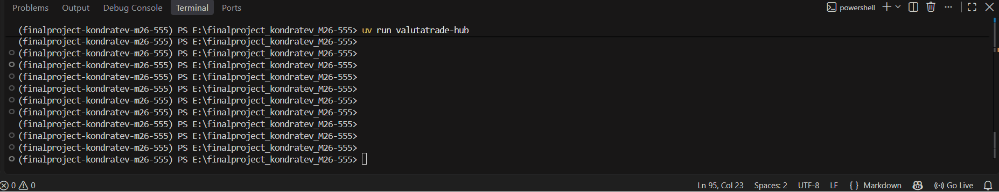

# ValutaTrade Hub

ValutaTrade Hub — консольная платформа для симуляции торговли фиатными и криптовалютами.
Приложение поддерживает пользователей, портфели, кошельки, покупку/продажу, получение курсов,
локальный кэш, историю курсов и отдельный Parser Service.

## Технологии

- Python 3.12+
- `uv` — управление окружением, зависимостями и сборкой
- `requests` — получение курсов из публичных API
- `prettytable` — форматированный вывод
- `ruff` — проверка стиля
- JSON — локальное хранилище

## Установка на Windows (PowerShell)

Рекомендуемая папка проекта: `finalproject_kondratev_M26-555`.

```powershell
git clone https://github.com/CeruleanDawn/finalproject_kondratev_M26-555
cd finalproject_kondratev_M26-555
uv sync
```

## Запуск

```powershell
uv run valutatrade-hub
```

После установки wheel-пакета как CLI-инструмента команда `valutatrade-hub` запускает приложение.

## Команды CLI

### Регистрация и вход

```text
register --username alice --password 1234
login --username alice --password 1234
logout
```

Пароль длиной менее четырёх символов не принимается. В JSON сохраняется SHA-256-хеш с уникальной солью; исходный пароль не сохраняется.

### Стартовый капитал

Новый портфель создаётся пустым. Чтобы симулировать сделку, внесите виртуальные средства:

```text
deposit --currency USD --amount 10000
```

`deposit` — вспомогательная команда для пополнения учебного кошелька; она не обращается к платёжным системам.

### Портфель и сделки

```text
show-portfolio
show-portfolio --base EUR
buy --currency BTC --amount 0.05
sell --currency BTC --amount 0.01
get-rate --from USD --to BTC
```

`buy` списывает эквивалент в USD и увеличивает баланс приобретаемой валюты.
`sell` списывает продаваемую валюту и зачисляет эквивалент в USD.
Все суммы должны быть положительными. При нехватке средств выбрасывается `InsufficientFundsError`.

### Parser Service

```text
update-rates
update-rates --source coingecko
update-rates --source exchangerate
show-rates
show-rates --currency BTC
show-rates --top 2
show-rates --base EUR
```

- CoinGecko используется для криптовалют BTC, ETH и SOL.
- ExchangeRate-API используется для фиатных валют.
- Ключ ExchangeRate-API читается из переменной окружения `EXCHANGERATE_API_KEY`.
- `rates.json` хранит последний срез; `exchange_rates.json` — историю обновлений.
- Настройка TTL по умолчанию — 300 секунд.
- При первом запуске пустой кэш получает демонстрационные котировки `DemoStub`, чтобы CLI можно было проверить без сети. Это учебные значения, не текущие рыночные цены; `update-rates` заменяет их после успешного ответа API.

Получить API-ключ: https://www.exchangerate-api.com/

В PowerShell ключ для текущей сессии задаётся так:

```powershell
$env:EXCHANGERATE_API_KEY = "ВАШ_КЛЮЧ"
uv run valutatrade-hub
```

В Ubuntu/bash используется `export EXCHANGERATE_API_KEY="ВАШ_КЛЮЧ"`.
Не храните настоящий ключ в исходниках или репозитории.

Без ключа ExchangeRate-API Parser Service всё равно может обновлять криптовалютные курсы через CoinGecko; обновление будет помечено как частичное, если фиатный источник недоступен.

Отдельный планировщик обновления курсов можно запустить командой:

```powershell
uv run valutatrade-update-rates
```

Он обновляет курсы с интервалом из конфигурации и завершается через `Ctrl+C`.

## Архитектура

```text
data/
  users.json
  portfolios.json
  rates.json
  exchange_rates.json
src/valutatrade_hub/
  logging_config.py
  decorators.py
  core/
    currencies.py
    exceptions.py
    models.py
    usecases.py
    utils.py
  infra/
    settings.py
    database.py
  parser_service/
    config.py
    api_clients.py
    updater.py
    storage.py
    scheduler.py
  cli/interface.py
main.py
```

- `User`, `Wallet`, `Portfolio` — доменные модели.
- `SettingsLoader` и `DatabaseManager` — Singleton-компоненты.
- `@log_action` пишет структурированные события BUY/SELL и пробрасывает исключения дальше.
- Логи ротируются в `logs/actions.log` и `logs/parser.log`.
- Доменные ошибки определены в `core/exceptions.py` и отображаются CLI понятными сообщениями.

## Проверка качества и сборка

Запуск встроенных тестов:

```powershell
uv run python -m unittest discover -s tests -v
```

Проверка стиля и сборка:

```powershell
uv run ruff check .
uv build
```

Проверка дистрибутивов в PowerShell:

```powershell
$files = Get-ChildItem .\dist -File |
    Where-Object { $_.Name -like "*.whl" -or $_.Name -like "*.tar.gz" } |
    Select-Object -ExpandProperty FullName
uvx twine check $files
```

В среде с GNU Make доступны `make install`, `make run`, `make lint`, `make build`.

## Данные и логи

Файлы `data/*.json` используются в качестве локального хранилища и входят в структуру проекта. Не добавляйте в коммиты реальные пользовательские данные. Перед финальным коммитом восстановите демонстрационные файлы, если запуск изменил их: `git restore data/users.json data/portfolios.json data/rates.json data/exchange_rates.json`.
Логи приложения находятся в `logs/` и исключены из Git.

## Демонстрация


